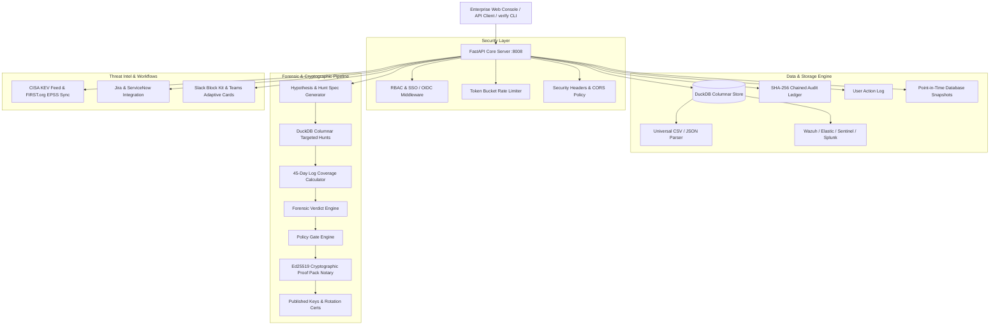

# Postern System Architecture

---

## 1. Overview

**Postern** is an enterprise patch assurance engine designed to answer the critical question before applying an emergency software update:
> *"Was this asset already exploited before the patch advisory was released?"*

Patching a compromised asset often blinds incident response teams by overwriting evidence, rebooting active processes, and leaving planted web shells or backdoor administrator accounts intact. Postern enforces a cryptographic **Patch Gate** that prevents patching until automated forensic hunts across SIEM/EDR telemetry confirm absence of pre-advisory compromise.

---

## 2. Core Architecture Modules

### 2.1 DuckDB Columnar Storage
Postern utilizes **DuckDB** as its internal vectorized, columnar query engine.
- Persistent database stored in `postern.duckdb` (or configurable volume mount).
- Point-in-time snapshot backup mechanism exports persistent Parquet/DuckDB snapshots to `backups/`.
- Queries evaluate 45-day lookbacks across multiple data sources (`endpoint`, `web`, `auth`, `network`, `dns`, `file`) with sub-millisecond columnar latency.

### 2.2 Forensic Pipeline: Advisory → Hunts → Verdict → Gate
1. **Advisory Parsing**: Normalizes vendor text, extracts CVE identifiers, affected versions, indicators of compromise, and dates.
2. **Hunt Specification**: Formulates targeted behavioral hypotheses (pre-auth web exploitation, planted web shells, outbound C2 beaconing, unauthorized user additions).
3. **Columnar Execution**: Queries DuckDB across each asset's telemetry window.
4. **Log Coverage Verification**: Calculates available retention days vs required lookback. Identifies coverage blindspots (< 85% coverage).
5. **Verdict Generation**:
   - `Likely compromised`: Evidence matches attack pattern. Gate = **Contain first then patch** (LOCKED).
   - `No evidence found`: Full lookback verified clean. Gate = **Patch now** (UNLOCKED).
   - `Cannot verify`: Log retention blindspot exists. Gate = **Patch with caution** (UNLOCKED with assumed-breach controls).
   - `Suspicious`: Partial behavioral anomaly. Gate = **Hold and review** (LOCKED).

### 2.3 Cryptographic Proof Packs & Public Verification
Every decision produces an independently verifiable **Proof Pack**:
- **RFC 8785 JSON Canonicalization (JCS)**: Normalizes key ordering, whitespace, and numbers.
- **Ed25519 Notary**: Asymmetric digital signature over the canonical manifest.
- **SHA-256 Merkle Evidence Hashes**: Canonical hash computed for each individual forensic event.
- **Published Public Keys**: `/v1/crypto/public-keys` exposes the notary certificate and key rotation chain.
- **Independent CLI Verification**: The standalone `verify_proofpack.py` script verifies signatures and evidence hashes completely offline.

### 2.4 Multi-Tenancy & RBAC
- **Roles**:
  - `Admin`: Full control, key rotation, connector setup, user management, backups.
  - `Approver`: Gate release approval, emergency overrides, two-person rule verification.
  - `Analyst`: Forensic triage, telemetry hunt execution, approval requests.
  - `Auditor`: Read-only verification of audit ledgers and proof packs.
  - `Viewer`: Dashboard and status summaries.
- **Tenant Isolation**: Cross-tenant data access is blocked by default at the route level.

### 2.5 Real Ingestion & Live Threat Intelligence
- **Connectors**: Wazuh API v4, Elasticsearch ECS, Microsoft Sentinel, and Splunk read-only adapters with SSRF protection.
- **Log Upload**: Universal CSV and JSON drag-and-drop ingestion with automatic column mapping into DuckDB.
- **Live Threat Intel**: Automated sync with official CISA Known Exploited Vulnerabilities (KEV) and FIRST.org Exploit Prediction Scoring System (EPSS).
